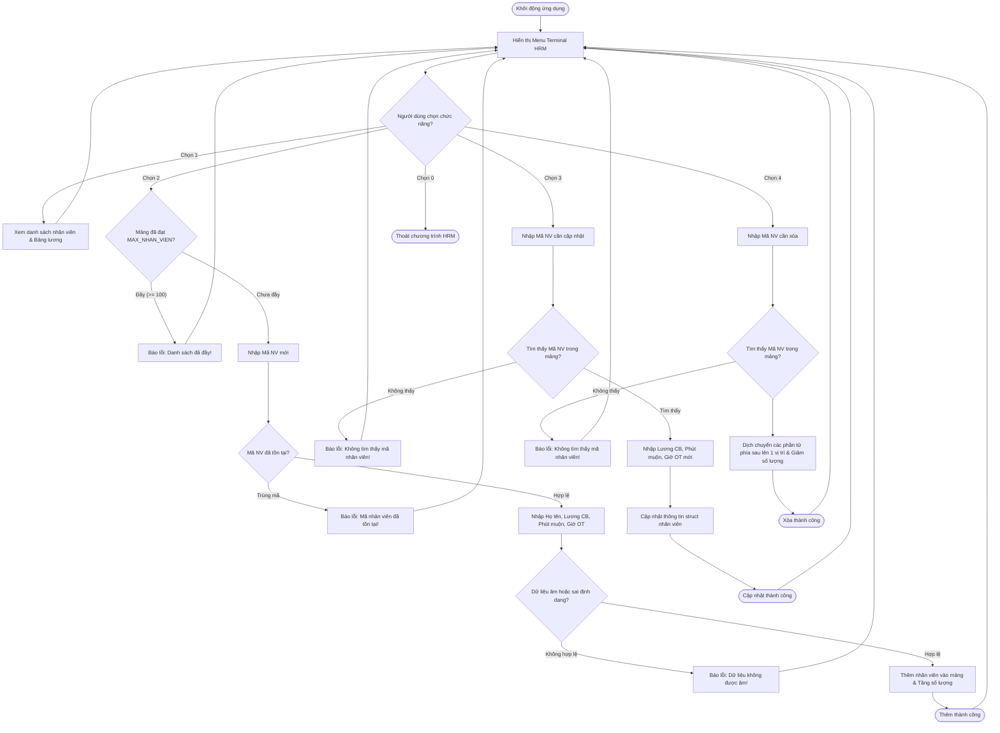

# BÁO CÁO HOÀN THIỆN MODULE QUẢN LÝ NHÂN SỰ VÀ CHẤM CÔNG HRM BẰNG C

> 👤 **Học viên:** Hoàng Công Dũng | **Mã SV:** PTIT-HCM-009
> 🏫 **Môn học:** it102-rl-hoangcongdung

---

## 📊 Sơ đồ thiết kế hệ thống (Activity Diagram)

> 💡 *Sơ đồ dưới đây được render tự động trực tiếp trên GitHub bằng Mermaid. Bạn cũng có thể tải file **`bt2.drawio`** trong repository này để mở và chỉnh sửa trực tiếp trên [Draw.io (diagrams.net)](https://app.diagrams.net).* 

---

## Nhiệm vụ 1: Phân tích Cấu trúc Dữ liệu và Quy tắc Nghiệp vụ HRM

Trong bài tập này, hệ thống quản lý nhân sự (HRM) yêu cầu sử dụng struct 'NhanVien' để lưu trữ thông tin gồm mã nhân viên ('maNV'), họ tên ('hoTen'), lương cơ bản ('luongCoBan'), phút đi muộn ('phutMuon'), và số giờ làm thêm ('soGioOT'). Giới hạn tối đa mảng là 100 nhân viên theo định nghĩa '#define MAX_NHAN_VIEN 100'.

Quy tắc nghiệp vụ tính lương và phạt đi muộn được áp dụng chặt chẽ: Nhân viên đi muộn từ 15 phút trở xuống không bị phạt, đi muộn trên 15 phút bị phạt cố định 50.000 VNĐ. Tiền làm thêm giờ (OT) tính theo công thức lấy số giờ OT nhân với lương giờ tiêu chuẩn (tính dựa trên 160 giờ làm việc trong tháng) và nhân hệ số 1.5. Lương thực nhận bằng tổng lương cơ bản cộng tiền OT trừ đi tiền phạt.

- Kiểu dữ liệu struct NhanVien đóng gói toàn bộ thuộc tính của một nhân sự.
- Công thức tiền phạt: tienPhat = (phutMuon > 15) ? 50000 : 0;
- Công thức tiền OT: tienOT = soGioOT * (luongCoBan / 160.0) * 1.5;
- Công thức lương thực nhận: luongThucNhan = luongCoBan + tienOT - tienPhat;

## Nhiệm vụ 2: Thiết kế Giải thuật Các Hàm CRUD và Xử lý Bộ đệm

Để chương trình tường minh và dễ bảo trì, mã nguồn được phân rã thành các hàm độc lập được khai báo nguyên mẫu trước hàm 'main()'. Hàm 'main()' chỉ đóng vai trò điều phối vòng lặp 'do-while' kết hợp cấu trúc 'switch-case'.

Đặc biệt chú ý xử lý bộ đệm bàn phím khi kết hợp giữa hàm 'scanf()' và 'fgets()'. Sau khi dùng 'scanf()' nhập số nguyên hoặc số thực, ký tự xuống dòng '\n' vẫn nằm lại trong bộ đệm, nếu gọi 'fgets()' ngay lập tức sẽ bị trôi lệnh nhập họ tên. Do đó, cần thêm lệnh xóa bộ đệm 'fflush(stdin)' hoặc vòng lặp 'while (getchar() != '\n');' một cách hợp lý.

- Hàm 'hienThiMenu()': In menu điều hướng Terminal trực quan.
- Hàm 'timKiemTheoMa()': Duyệt mảng tìm nhân viên theo 'maNV', trả về chỉ số (index) hoặc '-1' nếu không tìm thấy.
- Hàm 'hienThiDanhSach()': Duyệt vòng lặp in danh sách nhân viên cùng chi tiết bảng lương từng người và tổng số nhân viên.
- Hàm 'themNhanVien()': Kiểm tra mảng đầy, kiểm tra trùng mã, kiểm tra dữ liệu âm trước khi thêm mới.
- Hàm 'suaNhanVien()': Cho phép cập nhật lương cơ bản, phút đi muộn và giờ OT sau khi tìm thấy mã nhân viên.
- Hàm 'xoaNhanVien()': Xóa nhân viên bằng cách dịch chuyển các phần tử phía sau đè lên vị trí hiện tại và giảm biến đếm số lượng.

## Nhiệm vụ 3: Bảng Đặc tả Chi tiết Các Tình huống Kiểm thử (Edge Cases)

Dưới đây là bảng phân tích chi tiết các tình huống chạy thử chương trình (Test Cases) đảm bảo xử lý triệt để các bẫy dữ liệu theo yêu cầu đề bài:

| Tình huống | Thao tác đầu vào | Điều kiện kiểm tra | Kết quả mong đợi |
| --- | --- | --- | --- |
| Thêm nhân viên chuẩn | Nhập MaNV: 101, Tên: Nguyen Van A, Lương: 12tr, Phút muộn: 20, OT: 10 | Dữ liệu hợp lệ, chưa trùng mã | Thêm nhân viên thành công, trả về số lượng mới |
| Trùng mã nhân viên | Nhập lại MaNV: 101 khi đã tồn tại | Kiểm tra 'timKiemTheoMa() != -1' | In lỗi: 'Loi: Ma nhan vien da ton tai!' |
| Danh sách đầy | Thêm nhân viên khi số lượng đã đạt 100 | Kiểm tra 'soLuong >= MAX_NHAN_VIEN' | In lỗi mảng đầy, từ chối thêm mới |
| Hiển thị bảng lương | Chọn menu 1 | Duyệt mảng tính toán phạt, OT và lương thực nhận | In đúng số liệu chi tiết và tổng số nhân viên |
| Xóa nhân viên | Chọn menu 4, nhập MaNV cần xóa | Tìm thấy mã, dịch mảng phần tử phía sau lên trên | Xóa nhân viên thành công, giảm tổng số nhân viên đi 1 |

## Nhiệm vụ 4: Mã nguồn Chương trình Hoàn chỉnh (main.c)

Mã nguồn C11 hoàn chỉnh được viết sạch sẽ, tuân thủ chuẩn biên dịch 'gcc -std=c11 -Wall -Wextra main.c -o hrm_app', không sử dụng con trỏ nâng cao hay thư viện ngoài, đáp ứng toàn bộ tiêu chí kỹ thuật.

---

## 📁 Danh sách tệp tin nộp bài trong Repository
- 📝 `bt2.docx`: Báo cáo tài liệu phân tích nghiệp vụ hoàn chỉnh.
- 🎨 `bt2.drawio`: File thiết kế sơ đồ chuẩn theo quy định đề bài (mở trực tiếp bằng [Draw.io](https://app.diagrams.net) hoặc Lucidchart).
- 💻 `hrm_project/main.c`: Mã nguồn chương trình.
